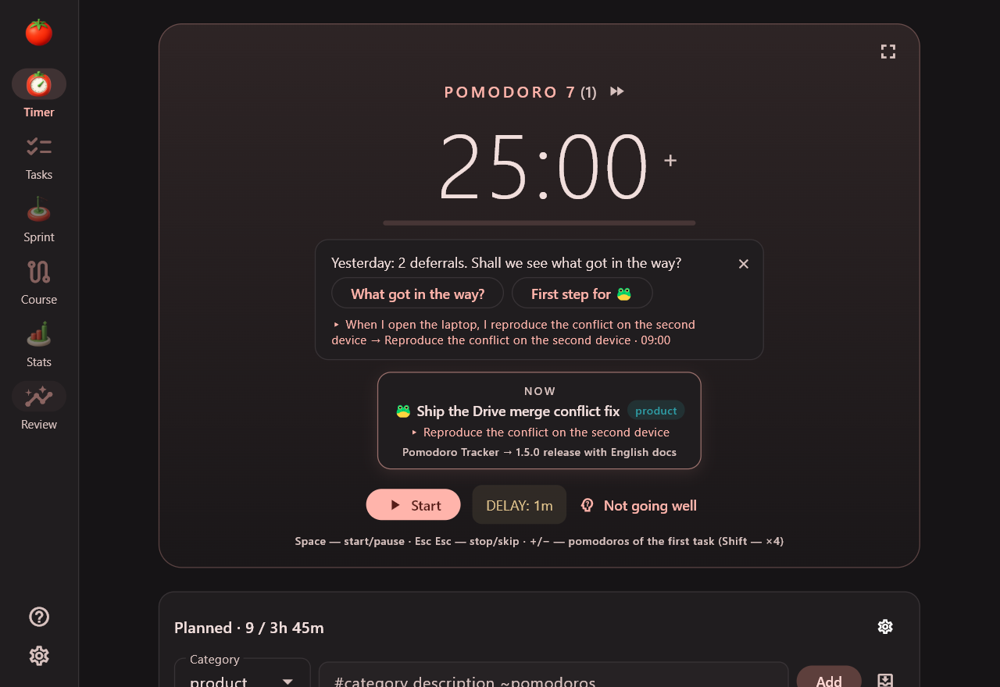
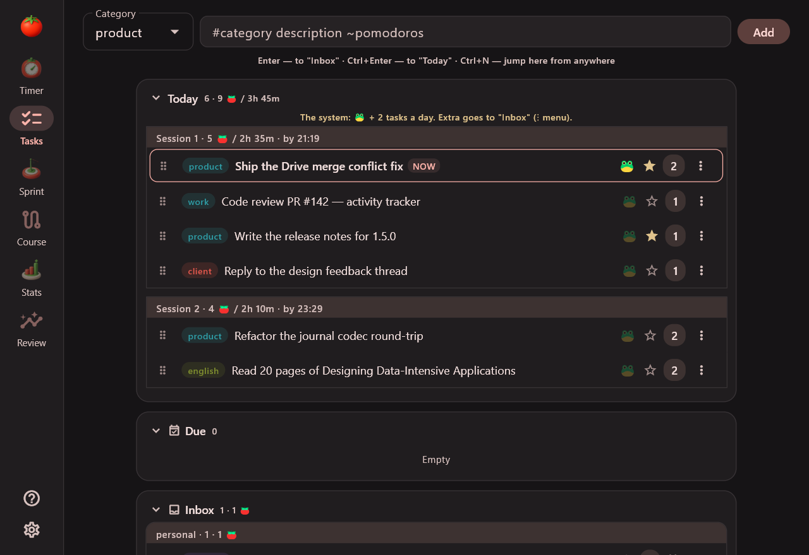
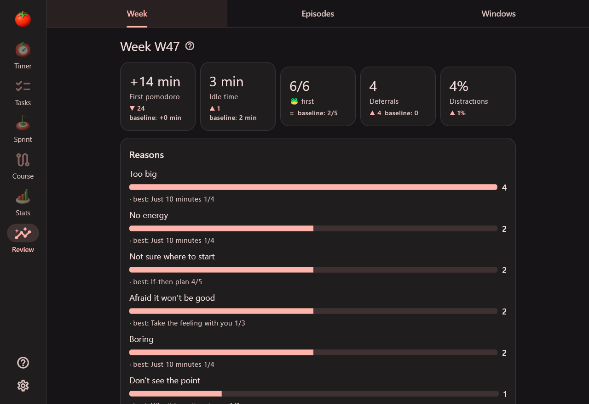
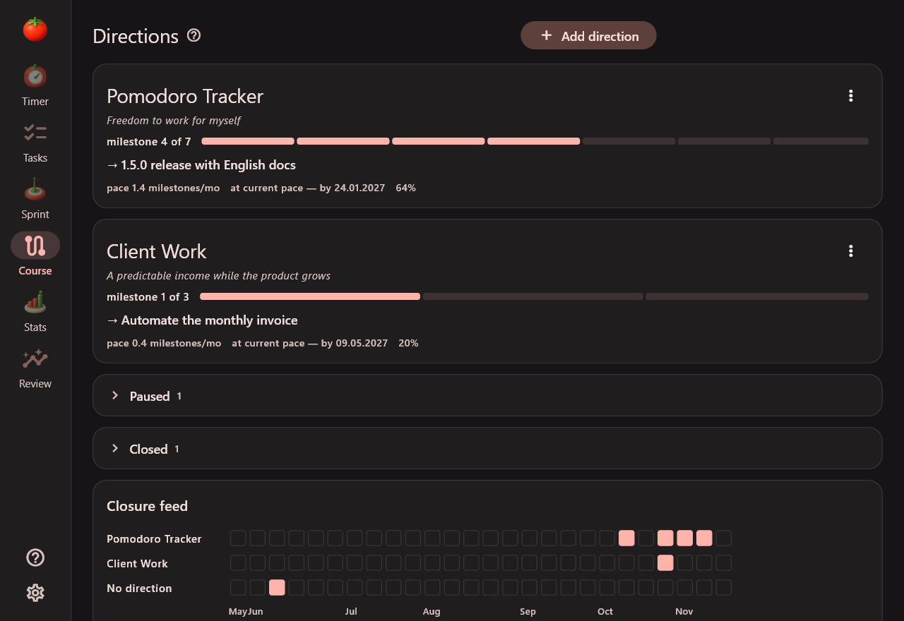
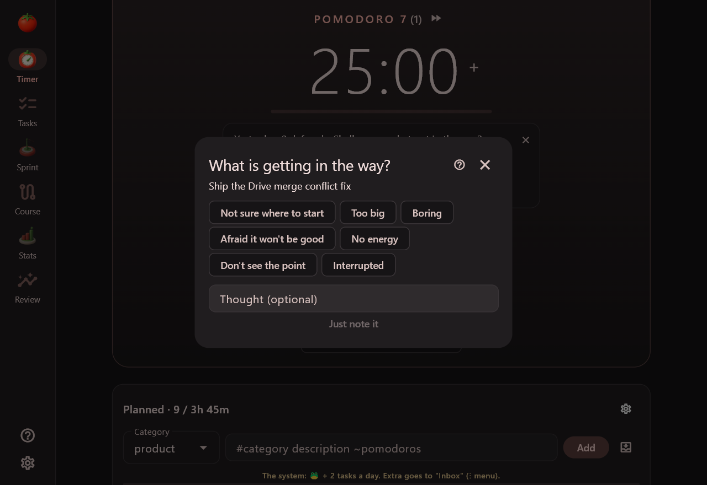

<div align="center">


# Pomodoro Tracker

**A Pomodoro timer and task manager for Windows and Android that plays well with Obsidian.**

A Pomodoro-technique timer with a precise model of series, idle time and
focus, a task screen with collapsible groups — plus a personal focus system
(frog of the day, sprint tasks, Flowtime) and self-observation: the app notices
when a task is not going, asks why, offers one approach and a week later checks
whether it helped. Tasks, pomodoro history and sprints
sync across devices through your own Google Drive and are mirrored into an
Obsidian vault as plain `.md` files for reading, search and git.

[Русский README](README.md)

[](LICENSE)
[](https://flutter.dev)
[](#quick-start)
[](#data-storage)
[](#tests)



</div>

No service accounts, no telemetry, no third-party servers: the only cloud is
your own Google Drive, and only if you connect it yourself. Without sync the
app is fully local. The single exception is the optional AI hints: they stay
off until you paste your own DeepSeek key ([what is sent](#ai-deepseek)).

## Why

Ordinary timers keep their history in someone else's database. Here it stays
with you: the working file lives in the app folder, and its readable mirror is
markdown in your own vault — visible in Obsidian's graph, searchable, and easy
to keep in git. Sync goes through your personal Drive, not through a
middleman service.

> 📘 **Not sure where to start?** — [How to use it](docs/HOW-TO-USE.md):
> the working order step by step, daily/weekly/monthly rituals, common
> mistakes. This README is the feature reference; that file is the operating
> manual. The same help lives inside the app: **F1** or the **"?"** button on
> the screens. [Русская версия](docs/КАК-ПОЛЬЗОВАТЬСЯ.md) is built from the
> same text.

---

## Contents

- [How to use it](docs/HOW-TO-USE.md) ← the working order, step by step
- [Quick start](#quick-start)
- [Screenshots](#screenshots)
- [Core concepts](#core-concepts)
- [Screens](#screens)
- [Focus system](#focus-system)
- [Keyboard shortcuts](#keyboard-shortcuts)
- [Smart task input](#smart-task-input)
- [Data storage](#data-storage)
- [Google Drive sync](#google-drive-sync)
- [Settings](#settings)
- [Exact behavior rules](#exact-behavior-rules)
- [Architecture](#architecture)
- [Development](#development)
- [Known limitations](#known-limitations)
- [Contributing](#contributing)
- [License](#license)

---

## Quick start

Ready-made builds are in [Releases](https://github.com/zFannur/pomodoro_tracker/releases/latest):

- **Windows** — `pomodoro_tracker-1.5.0-windows-x64.zip`: unpack and run
  `pomodoro_tracker.exe`, no installation needed.
- **Android** — `pomodoro_tracker-1.5.0.apk` (Android 7.0+).

The Windows build is not code-signed, so SmartScreen may show "Windows
protected your PC" — that is expected for an unsigned open-source exe.

From source:

```bash
flutter pub get
flutter build windows --release
# → build\windows\x64\runner\Release\pomodoro_tracker.exe

flutter build apk --release
# → build\app\outputs\flutter-apk\app-release.apk
```

On first launch the app creates a storage folder (`…\Obsidian\Помодоро` by
default) — the path can be changed in Settings.

Cross-device sync is optional: without it the app runs fully offline. See
[below](#google-drive-sync) for how to turn it on.

---

## Screenshots

Captured in the app on demo data, English interface, dark theme. All of them
live in [`docs/screenshots/`](docs/screenshots).

| Screen | File | What you see |
|---|---|---|
| Timer | [`timer.png`](docs/screenshots/timer.png) | Phase, day card, NOW card, "Not going well" |
| Timer, below | [`timer-planned.png`](docs/screenshots/timer-planned.png) | Sessions with estimates and finish time |
| Timer, "Done" | [`timer-done.png`](docs/screenshots/timer-done.png) | Today's journal and the daily-goal line |
| Tasks | [`tasks.png`](docs/screenshots/tasks.png) | Groups, 🐸/⭐, pomodoro counters |
| Sprint | [`sprint.png`](docs/screenshots/sprint.png) | Weekly milestone, ⭐ tasks, experiment |
| Course | [`course.png`](docs/screenshots/course.png) | Directions with pace and ETA |
| Course, milestones | [`course-milestones.png`](docs/screenshots/course-milestones.png) | The ladder and a rung's proofs |
| Stats, today | [`stats-today.png`](docs/screenshots/stats-today.png) | Tiles, categories, last 14 days |
| Stats, year | [`stats-year.png`](docs/screenshots/stats-year.png) | 365 days and the activity map |
| Review → Week | [`review-week.png`](docs/screenshots/review-week.png) | Tiles, causes, best approach |
| Review → Episodes | [`review-episodes.png`](docs/screenshots/review-episodes.png) | Episode feed with outcomes |
| Review → Windows | [`review-windows.png`](docs/screenshots/review-windows.png) | The activity tracker for a day |
| Settings | [`settings.png`](docs/screenshots/settings.png) | Schemes, auto-start, Flowtime |
| Help | [`help.png`](docs/screenshots/help.png) | Search and the 5-stage adoption path |
| Episode sheet | [`episode-sheet.png`](docs/screenshots/episode-sheet.png) | "What is getting in the way?" — 7 causes |
| Approach | [`episode-approach.png`](docs/screenshots/episode-approach.png) | The recommended approach and its record |

<br>







---

## Core concepts

| Concept | What it means |
|---|---|
| **Pomodoro** | A work interval (25 min by default). A completed pomodoro is written to the day's journal. |
| **Session** | A block inside "Today": a set of tasks with their total wall time and a finish time. Its bounds come from the session schedule or the session length. |
| **Series** | A running count of consecutive pomodoros. Every N pomodoros triggers a long break. Burns out after a long idle stretch. |
| **Task estimate** | Stored **in minutes**, not checkboxes. Pomodoros = `ceil(minutes / pomodoro length)`. |
| **Current task** | Always the **top** item in "Planned". Also shown in the "NOW" card. |
| **Logical day** | Runs **05:00 to 05:00**. A pomodoro at 00:30 lands in yesterday's file. |
| **Idle time (delay)** | Time while the timer is stopped or paused. Accumulates and lands on the next pomodoro record. |
| **Interruption** | Pausing a running pomodoro. Penalizes focus. |
| **Sprint** | A calendar week (Mon–Sun) with a milestone and a pomodoro goal. |
| **Direction** | A 3–12 month goal. Holds a list of categories, so all past journal history is attributed retroactively. |
| **Milestone** | A rung on a direction's ladder: a verifiable result for 1–3 weeks. Milestones have no dates — only relative order. |

---

## Screens

### Timer

A single-page flow:

1. **Timer** — large digits, a progress bar, color-coded by phase (work —
   tomato, break — green). The header shows the pomodoro number, the series
   `(N)`, and interruption tick marks `′′`. Next to it: "+1 min"
   (Shift — +5), skip the break and a fullscreen button; once stopped, a
   "skip the phase forward" arrow.
2. **NOW** — a card for the current task (WIP = 1).
3. **Planned** — the task list with estimates, a finish-time forecast, category
   counters and **sessions**: the list is split into blocks titled
   "Session 1 · 5 🍅 / 2h 35m · by 21:20", keyed to the session schedule or to
   the session length from Settings. The gear next to the header toggles
   "New tasks go to the top", "Remove task when a pomodoro finishes it" and
   offers "Clear list".
4. **Done** — today's pomodoro journal with focus, idle time and interruptions;
   the daily-goal line and a per-entry menu ("What was open", "Task windows",
   "Repeat", "Fill the gaps", "Delete").

The window title shows `MM:SS category` while running — visible from the
taskbar.

Above "NOW" sits the **Day card** (sleep, energy, "how was your day" in the
evening, a "Yesterday…" line and today's "if — then" plan); under the task name,
its **first step**; next to Start, a **"Not going well"** button that opens the
Episode sheet ("what is in the way?"). Details — [focus system](#focus-system)
and the in-app help (F1).

### Tasks

A full-screen task manager over the same list the timer uses:

- **Quick-add on top**: smart input, `Enter` — straight to Inbox (capture
  without deciding), `Ctrl+Enter` — to Today, `Ctrl+N` — jump here from
  anywhere in the app;
- **Collapsible groups** with counters and 🍅 totals: Today (with sessions) /
  Due / Inbox / Tomorrow / This week / Later / Done today / Done this week /
  Trash (collapse state is remembered);
- the first Today task is highlighted as **NOW** (WIP = 1);
- priority = tap 🐸 / tap ⭐ / drag (reordering works inside Planner buckets
  and across sessions);
- deleting shows an Undo snackbar;
- wide window (≥1000px) — two columns, narrow — one.

### Sprint

The weekly milestone, ⭐ sprint tasks (the "Pick" button opens the Planner),
"Done this week", fact tiles (Actual / Time / Velocity / Forecast), progress
toward the goal, a daily chart (tapping a day unfolds its journal) and week
history. Above the list sits the current **weekly experiment** card.

### Stats

Periods: Today / Week / Month / 365 days / Range.
Tiles: Pomodoros, Time, Focus, 🐸 Frogs, Best day.
Charts: by category, last 14 days, an activity heatmap (from 90 days).

> There's **deliberately** no "day streak" tile — a broken streak feeds
> self-criticism.

### Course

Strategic level above sprints and days (3–12 month horizon):

- **Direction cards** — active directions (focus on 2–4 main ones), milestone
  ladders with relative order and progress, next milestone, actual velocity
  calculation (milestones/mo) and estimated completion date;
- **"Why"** — an item in the direction's ⋮ menu: one line (up to 120
  characters) about what will change in your life once the direction is done.
  Shown on the card, written to `Курс.md`, and offered by the "Why this matters
  to me" approach when a task feels pointless;
- **Collapsible "Paused" and "Completed" blocks** — guilt-free pause and an
  archive of finished directions;
- **Weekly closures feed** — cross-direction chronicle of wins (`2026-W29`,
  `2026-W31`…);
- **30-day attention budget** — pomodoro distribution across directions
  (clearly shows where focus actually goes and what's starved);
- **Monthly review** — low-friction review at the start of each month:
  milestones closed, stalled directions (no closures for 6 weeks or more) prompting
  to pause or make #1.

### Review

The last tab (formerly "Activity") has three sub-tabs:

- **Week** — tiles (first pomodoro, idle, 🐸 first, deferrals, and on Windows
  distractions) with the change against last week and against the "observation
  week"; the week's causes and the approach that helped most; how well-being
  relates to work (once there is enough data); the **weekly experiment** —
  hypothesis, approach, metric, before/after and a verdict; the IPS procrastination
  scale once a month; "✨ AI review" if AI is on;
- **Episodes** — every "can't start / got distracted / stopped / deferred"
  moment of the last 14 days, filterable by cause: the approach and whether it
  worked. On Windows an idle episode has **"What was open instead"** — the
  windows that were open in place of a pomodoro;
- **Windows** (Windows only) — the activity tracker: how long in which app and
  tab, with a "distracting" mark. It also feeds **"Task windows"** (the task's ⋮
  menu — what was open across all of its pomodoros, with the share of
  distractions) and "What was open" for a single pomodoro. The data is local:
  windows during pomodoros are kept 60 days, outside pomodoros 14, and never go
  to sync or to AI.

The first week with episodes is the **observation week**: approaches are not
offered, so there is something to compare against (a "Help anyway" button is
there).

### Help

Opens with **F1** or the **"?"** button on the screens, and shows itself on
first launch. On the left — sections with search (Where to start, How it fits
together, One day, Week and month, When it is not going, Review and
experiments, Windows and distractions, AI hints, How to word things, Common
mistakes, Keys and input, Why it works); on the right — the section text and
the **5-stage adoption path**: Setup → Observation week → First experiment →
"If — then" and warm-up → Your own rhythm. Stage checks are derived from your
data (directions, session windows, episodes with a cause, days with 🐸…); only
"manual" steps are ticked by hand. The "Open" button on a step jumps to the
right screen.

At the bottom sits the "Adoption · stage 2 of 5" bar. The same text lives in the
repository: [`docs/HOW-TO-USE.md`](docs/HOW-TO-USE.md) and
[`docs/КАК-ПОЛЬЗОВАТЬСЯ.md`](docs/КАК-ПОЛЬЗОВАТЬСЯ.md) — both generated from
`lib/app/help_content.dart`.

---

## Focus system

On top of the classic timer, a personal focus system:

| Element | How it works |
|---|---|
| 🐸 **Frog of the day** | One per day, always at the top of the list. Set by tapping 🐸 on the Tasks screen or in the Planner (Sprint → "⭐ Pick"). **Resets every morning** (05:00 boundary). |
| ⭐ **Sprint task** | A weekly commitment that moves the milestone. The weekly milestone is a link to a ladder rung, and closing it moves the direction forward permanently. Set by tapping ⭐ on the Tasks screen or in the Planner. **Cleared automatically at the start of a new week.** Starring a task **records the specific rung** as a snapshot, not a live link: when a rung is closed and the next one steps into the sprint, commitments already taken are not re-attributed after the fact. A closed ⭐ task goes both to "Done this week" and to the rung's **proofs** — under a milestone you can see what actually closed it. |
| **NOW (WIP = 1)** | One task in progress — the top of the list. |
| **Flowtime** | The pomodoro finishes — the timer quietly keeps counting up (`+ MM:SS`) until you press "Done". Doesn't break your flow. Toggled in Settings. |
| **"Where did you leave off?"** | Stopping a running pomodoro asks a one-line question. The answer goes into the day journal's `## Notes`. Skippable. |
| **Stuck?** | Idle > 10 min → a "What is in the way →" chip opens the Episode sheet. On Windows, if you are at the computer, one notification arrives after 15 minutes (can be turned off). |
| **Episode sheet** | Three steps: a cause (one of 7: not sure where to start, too big, boring, afraid it won't be good, no energy, don't see the point, interrupted) → an approach (one of 9; the one that helped you most often comes first) → the action and the timer start. "Just note it" is always an option. |
| **Procrastination signals** | The app notices idle time, distraction during a pomodoro (Windows), a stopped pomodoro, a deferred task that was already due, and a 🐸 with no pomodoro all day. From the third deferral a task gets a `↻3` badge. Answering is optional. |
| **First step** | A ≤5-minute action on a task (the "Start plan" field in the editor). Shown under the title in "NOW". |
| **"If — then"** | "When ___, I ___": a situation (and optionally a reminder time) + the first step. The plan is shown in the morning and in "NOW". |
| **Warm-up** | A 10-minute pomodoro that does not end at the bell but flows into Flowtime. Next to it, an "honest rest": 10 minutes off-screen. |
| **Day card** | Sleep and energy in the morning, a day rating in the evening (1–5, one tap), a "Yesterday…" line without grades, and the "if — then" plan. Can be turned off in Settings. |
| **Weekly experiment** | One approach per week, the metric is computed automatically; at the end a verdict — works / no difference / worse / not enough data. A working approach moves to the front of the Episode sheet. |
| **Overload warning** | More than 3 tasks in a day → a reminder about "🐸 + 2 tasks". |
| **Frog stat** | "🐸 N / M" — days with a frog out of **active** days. No streak. |

**Buckets ≠ sprint.** The Planner (Due / Inbox / Tomorrow / This week / Later) is
about **due dates**; it opens from Sprint with the "⭐ Pick" button. Inside,
a "Today" tab shows the same sessions as the timer, plus four buckets with
🐸/⭐ toggles, due dates and counters. The sprint is only ⭐. A task can be in
Inbox and in the sprint at the same time.

**Category = project.** Categories are now grouped into **directions**
(strategic 3–12 month level), while Obsidian remains the place for "why"
and branching. There is deliberately no dependency graph in the app: task nodes
evaporate as they get done, edges would have to be redrawn every week, and the
answer to "what to do right now" is already given by 🐸 + the top of the list.
Group a project's tasks under one category and watch its counter.

---

## Keyboard shortcuts

| Key | Action |
|---|---|
| `Space` | Start / Pause |
| `Esc` `Esc` | Stop (or Skip break) — **double press**, second one within 1.5s. The button turns red while armed. |
| `+` / `−` | Pomodoros of the first task (`Shift` — by 4) |
| `Ctrl+N` | Tasks screen with the cursor in the quick-add field — from anywhere |
| `F1` | Help (the same as the "?" button on the screens) |

On the Tasks screen: `Enter` — to Inbox, `Ctrl+Enter` — to Today.
Click the pomodoro count: `+1`, `Alt`-click `−1`, `Shift` — ×4.
Shortcuts are disabled while a dialog is open or a text field is focused
(except `Ctrl+N`).

---

## Smart task input

In the description field:

```
#category Task description ~3
```

- `#category` — at the start of the line, sets the category;
- `~N` or `::N` — number of pomodoros (capped at 300 minutes);
- without them, the category from the dropdown and the active scheme's
  pomodoro length are used.

The **📥** button captures straight to "Inbox" — bypassing today's list.

---

## Data storage

**The source of truth is `data.json`** (on Windows
`%APPDATA%\com.local\pomodoro_tracker\`, on Android the app-private directory;
atomic writes, stable ids on every task and every pomodoro). One document for
everything: tasks, journal, sprints and tombstones of deleted records. That
same document is what syncs — so a closed task and the pomodoro it produced
always reach the other device together.

On first launch data is migrated automatically from whatever was there before:
tasks from `tasks.json`, journal and sprints from the vault's markdown. The
source files are not deleted — deleting `data.json` rolls everything back.

Next to it in the same folder live `settings.json` (settings, OAuth and AI
keys — **never** synced), `timer_state.json` (timer state used for restore) and
`activity.json` — the Windows window tracker: 60 days inside pomodoros, 14 days
outside them; it never goes to sync or to the AI.

Markdown in the storage folder (`…\Obsidian\Помодоро` by default) is a set of
**read-only mirrors**:

```
Помодоро/
├── Задачи.md                    # MIRROR of the task list
├── Курс.md                      # MIRROR of directions and milestones
├── Входящие.md                  # inbox: capture tasks from Obsidian
├── Журнал/
│   └── 2026-07/
│       └── 2026-07-16.md        # MIRROR: day's pomodoros + notes
└── Спринты/
    └── 2026-W29.md              # MIRROR: milestone, goal, daily facts
```

The folder and file names are fixed (`Задачи.md`, `Курс.md`, `Журнал/`, `Спринты/`) —
they don't change with the interface language, so your vault stays
consistent no matter which language you use day to day. The **UI language
switch only translates the app's own text**; the markdown format itself
(section headers, table columns) is fixed, and task/category names stay
exactly as you typed them.

### Mirrors are read-only

`Задачи.md`, `Курс.md`, `Журнал/*.md` and `Спринты/*.md` are regenerated on every change:
visible in Obsidian, searchable, versioned by git, and they double as a
human-readable emergency backup. **Edits to them are not read back and get
overwritten** (a note at the top says so). Edit the weekly milestone in the
app. Mirrors can be turned off in Settings.

`Входящие.md` is the only file read back.

Self-observation is mirrored in the same format: the day file gets
`## Самочувствие` and `## Откладывания` sections, the sprint file gets
`## Эксперимент` and `## Разбор`, and `Курс.md` gets a `> Зачем: …` line under a
direction. A task's start plan (first step, "when") deliberately does **not**
reach `Задачи.md`.

```markdown
<!-- Зеркало Помодоро Трекера: правки здесь не читаются. -->
# Задачи

## Сегодня
- 🐸 Сделать оплату #проекты ⏱ 50м ⭐
- Код-ревью PR 42 #работа ⏱ 25м

## Планировщик
- Посмотреть пример держателя #работа ⏱ 30м 📅 2026-07-18
```

- `🐸` — frog-of-the-day prefix; `⭐` — sprint-task suffix;
- `⏱ 50м` — estimate in minutes; `📅 2026-07-18` — due date (the Planner tab
  is computed from the date, and **overdue items automatically show up in
  "Inbox"**).

### Входящие.md ("Inbox.md") — capture from Obsidian

Write lines in any shape (`- buy a domain ~1 #misc`, checkboxes and list
markers welcome) — on startup and on window focus the app pulls them into
Inbox through the smart-input parser and resets the file to its template.
Strictly one direction (file → app), so there's nothing to merge. This is
how you add tasks from Obsidian or from your phone (the file syncs via
Google Drive).

### Журнал/YYYY-MM/YYYY-MM-DD.md ("Journal")

```markdown
---
дата: 2026-07-16
помидоры: 3
минуты: 75
простой: 7
прерывания: 2
фокус: 92%
цель: 8
---

# 16.07.2026 · 3 🍅 · 1ч 15м · фокус 92%

| Начало | Мин | Простой | Прерывания | Категория | Задача | Как |
| ------ | --- | ------- | ---------- | --------- | ------ | --- |
| 09:12 | 25 | 0 | 0 | работа | 🐸 Код-ревью | таймер |
| 10:05 | 25 | 7 | 2 | личное | Английский | вручную |

## Заметки
- 14:30 — встал на верстке карточки, не сходится отступ
```

- `🐸` on a task row = a pomodoro completed while it was the frog (used for
  the frog stat);
- `таймер` / `вручную` — logged by the running timer or entered manually;
- hours `00:00–04:59` belong to the next calendar date (logical day).

### Спринты/YYYY-Wnn.md ("Sprints")

Frontmatter (goal, milestone, week bounds, weekly facts), a `## Задачи
недели` snapshot, `## Сделано за неделю`, and a `## По дням` table.

Daily facts are not stored in `data.json` — they're derived from the journal.
That's why pomodoros don't push the sprint to Drive: the file only travels
when the goal, the milestone or the "done" list actually changes.

### Курс.md ("Course.md")

```markdown
<!-- Зеркало Помодоро Трекера: правки здесь не читаются. -->
# Курс

## Направления

### 1. Помидоро Трекер
> Зачем: свобода работать на себя
- горизонт: 2026-12
- заметка: [[Направления/Помидоро Трекер]]
- категории: проекты, работа
- веха 3 из 7 · темп 1.4 вех/мес

- [x] Синк без потерь данных `2026-W29`
  - ✅ 16.07 Слияние по id вместо выбора победителя #проекты
  - ✅ 18.07 Надгробия удалённых записей #проекты
- [x] Задачник со сворачиваемыми группами `2026-W31`
- [ ] Курс: направления и лестницы вех
- [ ] ...

## На паузе

### Английский — веха 2 из 5

## Закрытые

### Переезд — 4 из 4
```

### App settings

JSON, **not** in the vault: `%APPDATA%\com.local\pomodoro_tracker\settings.json`
(the folder name comes from `CompanyName` in `windows/runner/Runner.rc` — don't
change it, or the data ends up in a different directory).
Settings are local to the device and never synced — the OAuth keys live there.
`data.json` (all data) and `timer_state.json` (timer state used for restore)
sit next to it.

---

## Google Drive sync

All of `data.json` — tasks, journal and sprints — syncs across devices through
the **hidden app folder** (appDataFolder) on your Google Drive: the file is
invisible both in the Drive UI and to other apps. Settings stay local to each
device.

**How it works:**

- auto-sync on startup, on returning to the window/app (at most once a
  minute) and 5 seconds after any edit;
- the file is compared by its Drive revision: only the remote changed —
  pull; only we changed — push;
- a **conflict** (both devices changed) is resolved by **merging, not by
  picking a winner**: lists are unioned by id, so no task and no pomodoro is
  lost. The newer side only decides contested scalars — the daily goal and the
  weekly milestone. The losing version is additionally saved next door as
  `data_conflict.json`;
- **first connection** of a device to a non-empty Drive uses the same merge:
  nothing gets overwritten on either side.

### Deletions and tombstones

A "shorter file" is indistinguishable from "data hasn't arrived yet", so
deletions are recorded explicitly. On every write the repository diffs the set
of ids before and after: whatever disappeared becomes a tombstone with a
timestamp and travels with the data. Merging subtracts buried ids from every
list.

- deletion wins **unconditionally**: if a record was deleted on one device and
  edited on another, it stays deleted. Device clocks never decide a record's
  fate — clock drift between Android and Windows would bring back
  non-determinism;
- tombstones are produced by diffing at write time rather than at each deletion
  site, which covers every path at once — "minus" to zero, "Clear list",
  deleting a journal entry, merging tasks;
- restoring a record (from the trash) removes its tombstone;
- tombstones older than 90 days are pruned: by then the deletion has reached
  every device.

### Google Cloud setup (one-time)

1. [console.cloud.google.com](https://console.cloud.google.com) → create a
   project (any name).
2. **APIs & Services → Library** → enable the **Google Drive API**.
3. **APIs & Services → OAuth consent screen** → External → fill in the name
   and email → add yourself under **Test users** (no need to publish).
4. **Credentials → Create credentials → OAuth client ID:**
   - **Desktop app** — for Windows. Paste the Client ID + Client Secret into
     Settings → App → Google Drive → "Connect";
   - additionally for Android:
     - **Android** — package `com.zfannur.pomodoro_tracker` + the SHA-1 of the
       key the APK is actually signed with (`cd android && ./gradlew
       signingReport`, the `Variant: release` line). This client's values are
       never entered into the app — it exists so Google can recognise it;
     - **Web application** — paste its Client ID into the
       "Server Client ID (Web)" field in the app settings on the phone.

All three clients must live **in one project** with the Drive API enabled.

The only scope is `drive.appdata` — the app cannot see the rest of your
Drive. Per Google's policy the Desktop client secret is not treated as a
secret for installed apps; it is stored in your local `settings.json`.

**If sign-in fails with `DEVELOPER_ERROR`**, Google found no client matching
the app: usually the Android client holds the SHA-1 of a different key (debug
instead of release), or the clients are spread across separate projects.

---

## Settings

### Timer

- **Schemes** (up to 6): `classic` 25/5/15×4, `work` 50/10/20×2, `personal`
  30/2/25×4 — durations are editable, schemes can be added;
- auto-start pomodoro after a break / break after a pomodoro / only if tasks
  are queued;
- **Flowtime**;
- daily goal (0 — none, capped at 32), default sprint goal (40);
- **session length** (3 h by default, fractional allowed) and a **session
  schedule** — windows like `10:00–13:00`, `13:00–15:00`. With a schedule the
  Today lists split along those windows and a session's capacity is the window
  length; whatever does not fit becomes a tail sized by the session length. The
  schedule also sets the reference point for the "first pomodoro" metric in
  Review and the window inside which idle reminders are sent.

### Notifications

- volume, finish sound (10 melodies: bell, beep, chime, cuckoo, guitar,
  maramba, organ, rise, satellite, school), ticking (optional, including
  during breaks);
- system notifications, a one-minute warning, raising the window;
- **custom notification texts** — one per line, a random one is picked;
- **Telegram** — mirror notifications through your own bot (token + chat id);
- **"Remind me when idle"** and **"Alert when distracted during a pomodoro"** —
  self-observation notifications (Windows), one per idle stretch and per
  pomodoro.

### App

- theme: Light / Dark / System / **Auto** (light 07:00–18:59) / **Matrix**
  (black background, neon green, monospace font);
- **interface language** — Russian / English, switches instantly, no restart
  needed;
- date format (6 options) and time format (24h / 12h);
- storage folder and **mirroring tasks and course into the vault** (`Задачи.md`, `Курс.md`);
- categories and **scheme-per-category binding** (a task in that category
  gets that scheme's pomodoro length when estimated). A new category can be
  typed right in the task edit dialog — it registers instantly and shows up
  in every dropdown;
- **Day card on the timer** — show or hide it;
- **Google Drive** — task sync connection
  (see [the section above](#google-drive-sync)).

### AI (DeepSeek)

An optional tab. The AI **does not chat**: it fills three fixed slots in the
scenario, each has a rule-based fallback, and without a key everything else
works as before.

- **what it does:** ✨ suggests three first steps for a task; helps check a
  thought ("A more accurate thought"); writes the week's "AI review" (2–3
  sentences and up to three patterns) and may suggest an experiment. The answer
  is validated in code: unknown approaches and metrics are dropped, lengths are
  trimmed. If the text shows signs of a serious state, a suggestion to talk to a
  close person or a specialist is shown instead of a hint;
- **what is sent to the API** (`api.deepseek.com`, a server in China): the task
  text, its category and direction, the thought from the Episode sheet, the
  weekly numbers and up to 20 thoughts from episodes. **Never sent:** window
  titles, "where did you leave off" notes, keys of other services. Consent is
  asked before the first request;
- **where the key lives:** in the local `settings.json` (like the Telegram
  token); it never reaches sync or the mirrors — enter it separately on the
  phone. Next to it, a "Model" field (`deepseek-flash` by default) and a
  "Check" button.

Category names and the markdown files themselves always stay in whatever
language you typed them in — the interface language only affects the app's
own text, not your data.

---

## Exact behavior rules

The key rules that define timer and journal behavior:

- **Focus** = `0` for an empty day; otherwise `base = 1 − idle / (2 ×
  minutes)` (`0.5` when minutes is zero); with interruptions,
  `base = min(base, 0.99) ^ ((pomodoros + interruptions) / pomodoros)`;
  result clamped to 0..100.
- **Idle time** accumulates while the timer is stopped/paused and lands on
  the **next** record, capped at the pomodoro length. The **first record of
  the day** always has idle time `0`.
- **The series burns out** if the idle time before a start is longer than a
  long break. A long break also resets the series.
- **Anti-cheat**: a timer-sourced record can't be longer than the minutes
  that actually elapsed since the previous one.
- **Finish-time forecast** accounts for breaks and picks break type from the
  running series counter.
- **Restore**: timer state survives a restart if **less than 1 hour** has
  passed.
- **Day rollover** is caught live (checked once a minute): the "Done" list
  starts over, 🐸 resets, and ⭐ clears on a week change.
- **Single instance per system**: a second launch raises the existing window
  and exits (two processes would silently overwrite each other's data).

---

## Architecture

Flutter 3.44 / Dart 3.12, Windows desktop + Android. Layers:

```
lib/
├── app/            # strings.dart (all text, ru/en), theme.dart (all colors),
│                   # help_content.dart (help text and the adoption path)
├── core/           # failure.dart
├── domain/
│   ├── entities/   # PomoTask, PomoSession, DayLog, Sprint, Direction, Episode,
│   │               # Experiment, AppSettings
│   ├── insights.dart      # week metrics, approach success, experiment verdict
│   ├── strategies.dart    # causes, approaches, ranking
│   ├── adoption.dart      # adoption stages and auto-checks
│   └── repositories.dart
├── data/
│   ├── markdown_codec.dart       # pure serialize/parse (test-covered)
│   ├── data_merge.dart           # merging two data.json snapshots (pure)
│   ├── json_data_repository.dart # data.json: truth, migration, tombstones, mirrors
│   ├── activity_store.dart       # activity.json: windows and tabs (Windows)
│   ├── vault_repositories.dart   # vault access, inbox, settings
│   └── timer_state_store.dart
├── presentation/
│   ├── cubits/     # timer, tasks, journal, sprint, stats, settings, sync,
│   │               # insight, activity, directions
│   ├── screens/    # timer, tasks, sprint, course, stats, insight, help,
│   │               # planner_dialog, settings_dialog
│   ├── widgets/    # common.dart, day_card, episode_sheet, ips_dialog,
│   │               # windows_dialog, cause_chips, ai_consent
│   └── home_shell.dart
├── services/       # sound_service (WAV-synthesized sounds), notify_service,
│                   # nudge_service, activity_tracker, ai_service,
│                   # sync_auth (per-platform OAuth), drive_sync_service
└── main.dart       # dependency wiring, 🐸/⭐ rollover
```

- **State**: Cubit (`flutter_bloc`), states are `Equatable`.
- **Errors**: `Either<Failure, T>` (`fpdart`) at the repository boundary.
- **Colors** live only in `theme.dart`, **text** only in `strings.dart`.
- **File writes are atomic** (temp + rename) so Obsidian/Drive never see a
  half-written file. The repository and the sync use **different** temp names:
  a shared one already caused spliced content and broken JSON.
- **`JsonDataRepository` implements three interfaces at once** (tasks, journal,
  sprints): they read one document, so the in-memory state must be one. Hence
  `saveTasks`/`saveSprint` instead of a single `save`.
- **Merging is a pure function with no IO** — the nastiest part of syncing is
  covered by tests instead of by hand on two devices.
- **The repository writes what arrives from Drive** (`applyRemote`), not the
  sync service: otherwise the in-memory document would drift from disk and the
  next write would tombstone everything that had just arrived.

---

## Development

```bash
flutter pub get
flutter analyze          # should be clean
flutter test             # 633 tests
flutter run -d windows   # debug
flutter build windows --release
flutter build apk --release
```

### Documentation

| File | What it is |
|---|---|
| [`README.md`](README.md) / [`README.en.md`](README.en.md) | the feature reference |
| [`docs/HOW-TO-USE.md`](docs/HOW-TO-USE.md) / [`docs/КАК-ПОЛЬЗОВАТЬСЯ.md`](docs/КАК-ПОЛЬЗОВАТЬСЯ.md) | the operating manual; **generated** from `lib/app/help_content.dart` |
| [`CHANGELOG.md`](CHANGELOG.md) | version history |
| [`BUGS.md`](BUGS.md) | post-mortems of the defects found and fixed |

Help text is edited **only** in `help_content.dart` (ru and en stay in
lockstep), after which both documents are regenerated:

```bash
UPDATE_HELP_DOC=1 flutter test test/help_doc_test.dart
```

### Android

The signing key is configured in `android/key.properties` (not in git). The
fingerprint of that exact key is registered in Google Cloud — **changing the
key breaks Google sign-in**:

```bash
cd android && ./gradlew signingReport   # SHA-1 for the Cloud Console
```

### App icon

```bash
# assets/icon/logo.png (square, transparent background, some padding)
python tool/make_icon.py     # → Windows .ico + mipmap-*/ic_launcher.png
flutter build windows --release
```

A multi-resolution `.ico` is required: with a single 256px entry, Windows
crudely downscales it to 24px in the taskbar. After changing the icon you
may need to clear the Windows icon cache (`IconCache.db` + restart Explorer).

### Tests

`flutter test` — 633 tests across 50 files. The manual
(`docs/КАК-ПОЛЬЗОВАТЬСЯ.md`, `docs/HOW-TO-USE.md`) is generated from
`help_content.dart` and verified by a test.

- `test/markdown_codec_test.dart` — round-trip of tasks, journal (🐸, `|`,
  overnight pomodoros), sprint, `Курс.md` mirror (checkboxes, empty fields, `order`);
  the focus formula; logical date; ISO weeks.
- `test/course_test.dart`, `test/course_merge_test.dart`,
  `test/course_screen_test.dart`, `test/directions_cubit_test.dart` —
  course domain functions (ladders, velocity, completion ETA, attention budget),
  direction and milestone merging, state management, and the Course screen.
- `test/insights_test.dart`, `test/insight_cubit_test.dart`,
  `test/insight_entities_test.dart`, `test/insight_merge_test.dart`,
  `test/insight_repository_test.dart`, `test/insight_screen_test.dart` —
  week metrics, approach success, experiment verdict, merging of episodes,
  well-being and IPS, storage, and the whole Review screen.
- `test/strategies_test.dart` — causes, approaches and ranking.
- `test/episode_sheet_test.dart`, `test/insight_markdown_test.dart` — the
  Episode sheet and the self-observation mirrors (`## Самочувствие`,
  `## Откладывания`, `## Эксперимент`).
- `test/activity_tracker_test.dart`, `test/idle_segments_test.dart`,
  `test/windows_dialog_test.dart` — the window tracker: segments, idle time,
  browser tabs, windows outside pomodoros, and the "Task windows" /
  "What was open instead" dialogs.
- `test/nudge_service_test.dart`, `test/frog_rollover_test.dart` —
  procrastination signals, the "when" rules and session windows, 🐸/⭐ rollover.
- `test/p08_start_plan_test.dart`, `test/day_card_test.dart` — the start plan
  (first step, "if — then") and the Day card.
- `test/session_split_test.dart` — splitting the Today list into sessions by
  length and by the schedule windows.
- `test/help_content_test.dart`, `test/help_doc_test.dart`,
  `test/help_places_test.dart`, `test/help_screen_test.dart`,
  `test/help_shell_test.dart`, `test/adoption_test.dart` — help text, document
  generation, search, the adoption path and its auto-checks.
- `test/ai_service_test.dart`, `test/ai_widgets_test.dart` — DeepSeek answer
  validation, consent and the ✨ widgets.
- `test/timer_cubit_test.dart` — pomodoro/break cycle, series, pause and
  interruptions, stop, skip, prolong, smart input.
- `test/timer_screen_test.dart`, `test/tasks_screen_test.dart` — the main
  screen and the task manager at phone and wide widths, the direction thread,
  and the absence of the Planner button on the timer.
- `test/stats_frog_test.dart`, `test/stats_screen_test.dart` — counting days
  with a frog, and the stats layout (a width bug once broke it).
- `test/sprint_milestone_test.dart`, `test/star_milestone_test.dart`,
  `test/sprint_done_week_test.dart`, `test/day_and_sprint_details_test.dart` —
  the weekly milestone, the ⭐ rung snapshot, "Done this week", day details.
- `test/strings_test.dart` — interface language switching, localized time
  units.
- `test/json_data_repository_test.dart` — migration of tasks and journal,
  round-trip, deterministic ids on migration, tombstones, synthesized empty
  days, mirrors (including `Курс.md`), the inbox file, `applyRemote`.
- `test/data_merge_test.dart` — merging: union by id, delete-wins in both
  directions, survival of unknown sections, idempotence.
- `test/tasks_cubit_planner_test.dart`, `test/planner_buckets_test.dart`,
  `test/planner_edit_test.dart` — bucket reordering and editing, the trash,
  serialized disk writes.
- `test/drive_sync_test.dart`, `test/sync_regressions_test.dart`,
  `test/sync_auth_test.dart` — the Drive sync algorithm (push/pull, merge on
  first connect and on conflict, dirty-flag survival, sign-in called exactly
  once), regressions of the sync defects, and what is decided before Google
  sign-in is initialized.

---

## Known limitations

- **Markdown files are mirrors only**: edits to `Задачи.md`, `Курс.md`, `Журнал/*.md` and
  `Спринты/*.md` are never read back and get overwritten on the next write.
  Add tasks from Obsidian via `Входящие.md`; do everything else in the app.
- **Flowtime overtime doesn't survive a restart** — closing the app during
  overtime loses that pomodoro.
- **Android**: no notifications, and the timer only runs while the app is open
  (no background service, deliberately). The storage folder is fixed — picking
  a directory would yield a `content://` URI rather than a path.
- **Day notes and "Done this week" merge by text**, not by id: two literally
  identical lines added on different devices collapse into one. They have no
  delete action in the UI, so giving them ids wasn't worth it.
- **`data.json` grows** — roughly a third of a megabyte per year at ten
  pomodoros a day, and it's uploaded whole on every sync. When that starts to
  hurt, the cheap ways out are compression or moving old years into a separate
  unsynced file. Sharding now would be a bet on a future that may not arrive.
- **Changing the Android signing key breaks Google sign-in**: the Cloud
  Console has the fingerprint of one specific key.
- Deliberately without server-side features: accounts, leaderboards,
  sharing, integrations (Slack/Trello/Todoist, apart from the Google Drive
  sync), email reports, recurring tasks — this is a focused local tool, not
  a SaaS platform.

---

## Contributing

This is a personal project, but PRs and issues are welcome.

Before a PR:

```bash
flutter analyze   # should be clean
flutter test      # all green
dart format lib test
```

Codebase rules:

- **colors** only in `lib/app/theme.dart`, **text** only in
  `lib/app/strings.dart`;
- repositories return `Either<Failure, T>`, the `domain` / `data` /
  `presentation` layers stay separate;
- markdown parsing logic lives in `markdown_codec.dart` (pure functions) and
  is test-covered;
- any timers are cancelled in `close()` / `dispose()`;
- deliberate simplifications are marked with a `// ponytail:` comment
  naming the ceiling of the shortcut.

Changes to core behavior rules (the focus formula, idle time, series, the
logical day) need a test.

## License

[MIT](LICENSE) © zFannur

"Pomodoro Technique" is a trademark of Francesco Cirillo; this project is
not affiliated with, and is not an official implementation of, the
technique.
